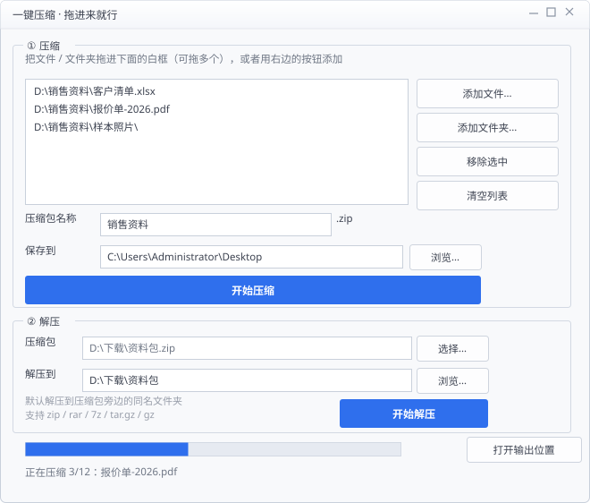

# 一键压缩 · MasuitZip Toolkit

一个 Windows 上的压缩/解压小工具，用来替掉系统自带那个「右键 → 发送到 → 压缩(zipped)文件夹」的繁琐流程：
**把文件拖进窗口 → 改个名字 → 点一下**，完事。

仓库里有两个程序，共用同一套核心逻辑（`ZipEngine`）：

| 程序 | 形态 | 适合谁 |
|---|---|---|
| **一键压缩**（`MasuitZip`） | WinForms 桌面窗口，单文件 exe，双击就能用 | 日常手动压缩/解压 |
| **MasuitUnzip** | 命令行 / 拖拽到 exe 图标上 | 批处理、脚本、只想解一个包 |

解压的格式自动识别部分基于 [Masuit.Tools（码数吐司库）](https://www.masuit.tools/) 的 `SevenZipCompressor`，其余走 .NET 自带 API。

## 直接下载（免编译）

到 [Releases](../../releases/latest) 页面下载，解压即用（需要 .NET 8 运行时）：

| 附件 | 解压后得到 | 说明 |
|---|---|---|
| `MasuitZip-1.0.0-win-x64.zip` | `一键压缩.exe` | 桌面版，双击打开窗口 |
| `MasuitUnzip.exe` | 直接运行 | 命令行版 |

> 桌面版打成 zip 是因为 GitHub 附件名不支持中文，直接传中文名会变成 `default.exe`。



---

## 功能特点

- **拖进来就行**：文件和文件夹可以混着拖，也可以点按钮选；支持多选。
- **一键到底**：默认压缩包名取第一个条目名，默认存到桌面，改不改都行。
- **实时进度**：底部进度条 + 「正在压缩 3/12：xxx.pdf」这类逐文件提示，完成后弹窗报文件数 / 大小 / 用时，并可直接跳到输出文件夹。
- **中文名不乱码**：Windows 中文系统打出来的 zip（GBK 文件名）会自动识别并按 GBK 解码，不会出现 `¹¤×÷` 这种乱码。
- **看文件头不看扩展名**：判断是不是 zip 读的是 `50 4B 03 04` 魔数，扩展名写错也能解。
- **防 zip-slip**：压缩包里带 `..\..\` 这类越界路径会被跳过，不会往上写文件。
- **压缩包通用兼容**：压缩用 Deflate，压出来的 zip **Windows 资源管理器双击就能打开**（不是只有第三方软件能读的 LZMA）。
- **不易误操作**：处理中按钮锁死，关窗口要二次确认；解压失败不留下空文件夹。

## 环境要求

- Windows 10 / 11（WinForms 依赖 `net8.0-windows`，不支持 Linux/macOS）
- [.NET 8 SDK](https://dotnet.microsoft.com/download/dotnet/8.0)（仅编译需要；用已发布的 exe 只需 .NET 8 运行时）
- Python 3（仅用于生成图标 `app.ico`，可选）

## 编译与运行

```bash
git clone https://github.com/LXR555/masuit-zip-tools.git
cd masuit-zip-tools

# 1) 生成图标（可选，跳过则 exe 没有图标，不影响功能）
cd src/MasuitZip && python make_icon.py && cd ../..

# 2) 编译桌面版
dotnet build src/MasuitZip/MasuitZip.csproj -c Release
dotnet run --project src/MasuitZip/MasuitZip.csproj

# 3) 打包成单个 exe（不依赖目标机装 SDK，但仍需 .NET 8 运行时）
dotnet publish src/MasuitZip/MasuitZip.csproj -c Release -r win-x64 \
  --self-contained false -p:PublishSingleFile=true \
  -p:IncludeNativeLibrariesForSelfExtract=true -p:DebugType=None -o publish

# 4) 编译命令行版
dotnet build src/MasuitUnzip/MasuitUnzip.csproj -c Release
```

自检（不需要点界面，跑完把结果写到 exe 同目录 `selftest-report.txt`）：

```bash
publish/一键压缩.exe --selftest
type publish/selftest-report.txt
```

## 桌面版怎么用

### 压缩（3 步）

1. **加内容** —— 把文件/文件夹拖进窗口白框（可多个、可混合），或点「添加文件…」「添加文件夹…」。
2. **起名、选位置** —— 压缩包名称默认取第一个条目名；保存位置默认桌面，点「浏览…」可改。
3. **点「开始压缩」**。

### 解压（2 步）

1. 点「选择…」挑压缩包（也可把单个压缩包直接拖进窗口，解压区自动填好）。
2. 「解压到」会自动填成**压缩包旁边的同名文件夹**，点「开始解压」。

> 想固定到任务栏：右键 exe → 「固定到任务栏」。想开机自启：`Win+R` → `shell:startup` → 把 exe 的快捷方式放进去。

## 命令行版怎么用

```text
MasuitUnzip.exe <压缩包>                      解压到同名文件夹
MasuitUnzip.exe <压缩包> --here               解压到压缩包所在目录（不建子文件夹）
MasuitUnzip.exe <压缩包> -o <目录>            解压到指定目录
MasuitUnzip.exe -l <压缩包>                   只看内容（仅 zip）
MasuitUnzip.exe -z <输出.zip> <文件/文件夹…>  压缩
MasuitUnzip.exe -h                            帮助

加 --no-pause（或 -n）不等待回车，方便脚本调用。
不带任何参数直接运行时进入交互模式，可以把压缩包拖进窗口。
```

## 支持的格式

| 格式 | 解压 | 压缩 | 进度显示 |
|---|:--:|:--:|---|
| `.zip` | ✅ | ✅ | 百分比 |
| `.tar` / `.tar.gz` / `.tgz` | ✅ | — | 滚动 |
| `.rar` | ✅ | — | 滚动 |
| `.7z` | ✅ | — | 滚动 |
| `.gz` / `.bz2` / `.xz`（单文件） | ✅ | — | 滚动 |

**不支持**：带密码的压缩包、分卷压缩包（`.part1.rar`、`.z01` 等）。

## 实现分工（为什么这么写）

| 环节 | 用的 API | 原因 |
|---|---|---|
| 压缩 | `System.IO.Compression.ZipArchive` + `CompressionLevel.Optimal` | Masuit.Tools 的 `Zip()` 把压缩类型写死成 `LZMA`（见 [SevenZipCompressor.cs](https://github.com/ldqk/Masuit.Tools/blob/master/Masuit.Tools.Abstractions/Files/SevenZipCompressor.cs)），压出的 zip Windows 资源管理器打不开，所以只用它解压、不用它压缩 |
| zip 解压 | `ZipFile.Open(..., encoding)` | 需要逐条目回调进度，也需要能强制指定 GBK；`ZipFile.OpenRead` 没有 encoding 参数 |
| tar / tar.gz | `System.Formats.Tar` + `GZipStream` | Masuit.Tools 走 SharpCompress，0.50 起工厂方法改成了 `OpenArchive` / `OpenReader`，`Decompress` 对 tar.gz 会抛 `Cannot determine compressed stream type`（实测），所以 tar 系列交给 BCL |
| rar / 7z / gz / bz2 / xz | `Masuit.Tools.Files.SevenZipCompressor.Decompress` | 这些格式 .NET 不自带，交给 Masuit 自动识别 |
| GBK 判定 | 同一份文件名先按默认编码、再按 GBK 各解一遍，只有 GBK 能解出汉字才认定为 GBK | 比看 `0x800` 语言标志位（常被写错）更可靠 |

## 已知限制

1. **rar / 7z / bz2 / xz 未实测** —— 开发机上没有能生成这几种样本的工具，代码走的是和已验证格式同一条 `SevenZipCompressor` 通路，但缺实测数据。
2. **没有密码输入入口** —— 遇到加密包会直接报错。
3. **解压同名文件直接覆盖** —— 这是 zip 的通用行为；压缩时若已有同名 zip 才会询问是否覆盖。
4. **只支持 Windows** —— WinForms + `net8.0-windows`。

## 实测记录

`--selftest` 真实输出（2026-10-24，.NET 8.0.426 / Masuit.Tools.Abstractions 2026.3.4）：

```text
自检结果：全部通过

[压缩] 文件 2 个，源数据 25 B，压缩包 310 B，用时 8 ms
[解压 zip] 文件 2 个，用时 4 ms，中文文件名与目录结构：正确
[解压 tar.gz] 文件 2 个，用时 9 ms，内容：正确
[校验] 压缩包条目 2 个，可正常打开：是
```

命令行版另做过回归：UTF-8 中文名 zip、GBK 中文名 zip、tar.gz、自压 zip 回环、损坏文件报错并清理空目录，均符合预期。

## 目录结构

```text
masuit-zip-tools/
├─ src/
│  ├─ MasuitZip/            桌面版（WinForms，纯代码无设计器）
│  │  ├─ MainForm.cs        界面与交互
│  │  ├─ ZipEngine.cs       压缩/解压核心（两个程序共用逻辑）
│  │  ├─ Program.cs         入口，含 --selftest / --shot 开发开关
│  │  ├─ SelfTest.cs        无人值守自检
│  │  ├─ UiShot.cs          把界面离屏渲染成 PNG，用于检查布局
│  │  └─ make_icon.py       生成 app.ico（PNG-in-ICO，不依赖 Pillow）
│  └─ MasuitUnzip/          命令行版
│     └─ Program.cs
├─ docs/
│  └─ ui-mockup.svg         界面示意图
├─ masuit-zip-tools.sln     两个项目的解决方案
├─ .gitignore
├─ LICENSE                  MIT
└─ README.md
```

## 常见问题

**Q：解压出来还是乱码？**
先确认压缩包是不是 GBK 命名（本工具会自动判断）。如果文件名在压缩时就已经被别的软件弄坏了，无法还原。

**Q：压缩很慢？**
单线程逐文件复制，瓶颈在磁盘；几 GB 的文件夹会明显慢，进度条会一直动，不是卡死。

**Q：能做成右键菜单吗？**
可以：把 exe 的快捷方式放进 `%APPDATA%\Microsoft\Windows\SendTo`，之后右键文件 → 发送到 → 一键压缩。

## 许可证

[MIT](LICENSE) © 2026 刘军平
